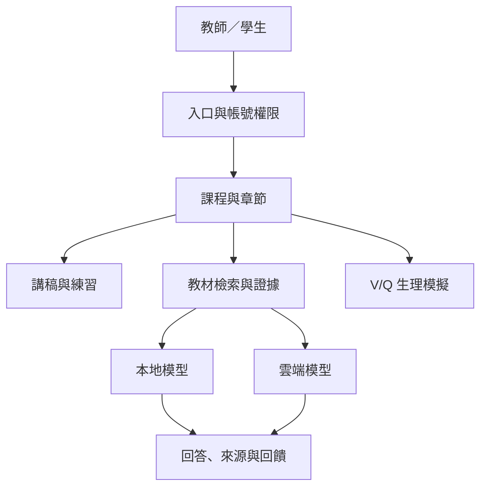

# NTU-LUNGTA

### Course-Adaptive Virtual Human Teaching Assistant


**以教材為依據，整合虛擬人講解、課程問答、情境練習與呼吸生理模擬的教學系統。**

國立臺灣大學生理學研究所碩士研究專案。系統以呼吸生理為內建教學情境，並提供教師上傳 PDF、建立課程與讓學生加入課程的流程。研究評估著重回答正確率、回覆時間與個別功能的技術驗證。

[快速開始](#快速開始) · [系統架構](docs/architecture.md) · [程式導覽](docs/code-map.md) · [評測與資料](docs/evaluation.md) · [展示流程](docs/demo-guide.md) · [版本紀錄](CHANGELOG.md)

## 專案狀態

| 項目 | 說明 |
|---|---|
| 程式基底 | `v241.12.5-full-answer-voice`，包含 R12 帳號與課程權限更新 |
| 主程式目錄 | [`NTULUNG_TA_v241_12_1_QUIZ_NAV_VERIFIED/`](NTULUNG_TA_v241_12_1_QUIZ_NAV_VERIFIED/)；目錄沿用舊名稱，版本關係見[整理紀錄](docs/repository-status.md) |
| 介面 | 原生 HTML / CSS / JavaScript；繁體中文教學內容、語音與虛擬人呈現 |
| 後端 | Python HTTP 服務、SQLite、Ollama；公開入口使用 Cloudflare Worker 與 Tunnel |
| 檢索 | BGE-M3 向量檢索、語義視窗重排；內建教材檢索另有失敗備援 |
| 研究系統入口 | [開啟 NTU-LUNGTA](https://lungta.twchu.workers.dev)（需已核准帳號） |

## 教學功能

| 功能 | 使用方式 | 主要實作 |
|---|---|---|
| Teacher Lecture | 依所選課程與章節呈現講稿，搭配虛擬人與語音播放 | `course_runtime.py`、前端 `55_v241_course_adaptive_ta.js` |
| Student Q&A | 將問題與教材證據送交所選模型，顯示回答與來源 | `reference_search.py`、`reference_server.py`、Worker |
| Scenario Practice | 建立章節題庫、抽題、自由跳題與查看作答回饋 | `exam_questions.py`、`course_runtime.py` |
| V/Q Visual Model | 調整通氣、灌流及氣體交換參數，觀察耦合計算結果 | `35_hopkins_reference_lung_physiology.js` |
| Course Management | 教師上傳 PDF、選擇章節、準備教材；學生以課程代碼加入 | `course_runtime.py`、`lungta_auth.py` |
| Feedback & Roles | 答案回報、帳號申請審核、教師／學生權限與課程存取檢查 | `feedback/`、`gateway.py`、`lungta_auth.py` |

上傳課程的題庫以每單元 100 題為目標，實際可用題數取決於教材及生成／審查結果。V/Q 模擬適用於呼吸生理內容；其他科目的上傳功能不等於已完成跨學科教學效果驗證。

## 系統流程



服務埠、程式責任與兩種檢索路徑見[系統架構](docs/architecture.md)。

## 快速開始

### 先查看程式並執行離線驗證

需要 Git、Python 3.12 與 Node.js 22 或 24。以下流程使用現有測試中的模擬資料，無須 GPU、教科書全文或 API 金鑰。

```bash
git clone https://github.com/Wayne59882/NTU-LUNGTA.git
cd NTU-LUNGTA
python3 scripts/check_offline.py
```

Windows 可將 `python3` 改為 `py -3`。檢查包含 Python／JavaScript 語法、V/Q 守恆、測驗跳題、批次回覆復原與語音控制。測試範圍見[驗證說明](docs/testing.md)。

### 啟動完整教學服務

完整服務需要另外準備模型、語音辨識環境與合法取得的教材。請依[安裝與設定](docs/getting-started.md)完成伺服器環境，再啟動主程式。公開程式庫未包含伺服器私有資料，複製程式碼後仍須完成設定。

目前介面提供兩個本地回答模型及雲端模型選項。模型標籤、執行環境與評測設定須分別記錄，詳見[模型與評測對照](docs/evaluation.md)。

## 閱讀專案

| 想了解的內容 | 從這裡開始 |
|---|---|
| 如何安裝、設定與檢查服務 | [Getting Started](docs/getting-started.md) |
| 問題如何經過檢索與模型產生回答 | [Architecture](docs/architecture.md) |
| 功能對應哪個程式檔 | [Code Map](docs/code-map.md) |
| 正確率與等待時間如何定義、有哪些資料 | [Evaluation](docs/evaluation.md) |
| 如何重跑現有的離線驗證 | [Testing](docs/testing.md) |
| 向老師展示哪些畫面與證據 | [Demo Guide](docs/demo-guide.md) |
| 現有版本、目錄與 Git 歷程的關係 | [Repository Status](docs/repository-status.md) |
| 後續如何提交修改與附驗證結果 | [Contributing](CONTRIBUTING.md) |

## 公開內容與研究界線

公開內容包括程式、介面資產、測試腳本與部分既有評測資料。教科書全文、模型權重、教師上傳課程、帳號資料庫與金鑰不包含在公開重現流程中。資料位置及缺漏見[評測與資料](docs/evaluation.md)。

離線功能驗證、模型正確率與教學效果是不同的結果。現有功能檢查通過，僅支持該測試所檢查的行為；學習成效仍需另外設計教學研究。

## 作者與引用

朱庭汶 · 國立臺灣大學生理學研究所。引用資訊見 [`CITATION.cff`](CITATION.cff)。本儲存庫尚未提供 `LICENSE`；引用資訊本身不設定程式、教材、模型或資產的授權條款。
