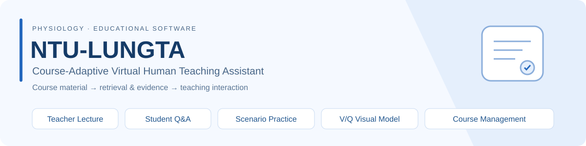
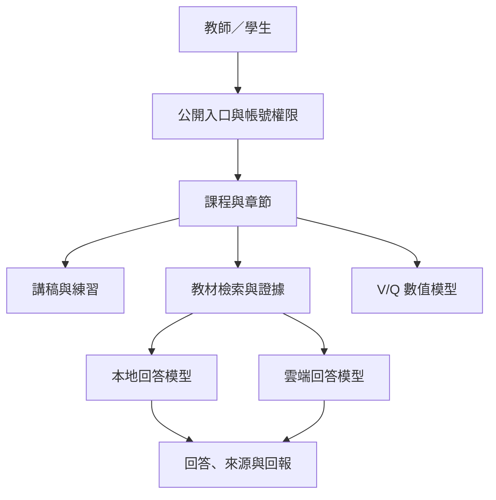

# NTU-LUNGTA

### Course-Adaptive Virtual Human Teaching Assistant



**整合教材檢索、虛擬人講解、課程問答、情境練習與通氣／灌流模擬的教學系統。**

國立臺灣大學生理學研究所碩士研究專案。系統以呼吸生理作為內建教學情境，並讓教師上傳 PDF、依章節建立教材與練習，再由學生使用課程代碼加入。研究重點包括教材對應的回答、課程操作整合，以及回答正確率與等待時間的技術評估。

[研究系統入口](https://lungta.twchu.workers.dev)（需已核准帳號） · [安裝說明](docs/getting-started.md) · [程式導覽](docs/code-map.md) · [評測說明](docs/evaluation.md)

## 目錄

- [專案目的](#專案目的)
- [主要功能](#主要功能)
- [執行環境](#執行環境)
- [快速開始](#快速開始)
- [安裝與啟動](#安裝與啟動)
- [操作流程](#操作流程)
- [系統架構](#系統架構)
- [設定](#設定)
- [專案結構](#專案結構)
- [測試與評測](#測試與評測)
- [常見問題](#常見問題)
- [資料與目前限制](#資料與目前限制)
- [版本與引用](#版本與引用)

## 專案目的

本專案把教材準備、講解、自由提問、練習與呼吸生理模擬整合在同一個教學介面。學生的問題可經教材檢索取得支持段落，再交由本地或雲端回答模型處理；教師可透過課程與章節管理，維持教材和教學活動之間的關係。

系統目前的研究定位是軟體開發與技術表現評估。回答是否正確、等待時間多長、操作是否符合預期，分別以對應資料與測試檢查；學習成效需要另外設計教學研究。

## 主要功能

| 模組 | 功能與使用方式 |
|---|---|
| **Teacher Lecture** | 選擇課程及章節，呈現講稿，搭配虛擬人與語音播放。 |
| **Student Q&A** | 輸入文字或透過語音提問，依教材證據產生回答；本地與雲端模型的執行路徑分開管理。 |
| **Scenario Practice** | 依章節準備題庫、抽題、自由跳題、保留選項，並顯示作答回饋。 |
| **V/Q Visual Model** | 調整通氣、灌流與氣體交換參數，觀察耦合計算的變化；包含守恆及參考案例檢查。 |
| **Course Management** | 教師上傳 PDF、確認章節、準備課程內容；學生以課程代碼加入。 |
| **Accounts & Feedback** | 帳號申請與管理員審核、教師／學生權限、課程存取，以及答案回報。 |

上傳課程以每單元 100 題作為題庫目標，實際可用題數受到教材內容及生成／審查結果影響。呼吸生理模擬僅適用於相關課程；支援上傳其他教材，不表示已驗證所有科目的教學表現。

## 執行環境

| 使用範圍 | 需要的環境 |
|---|---|
| 閱讀與離線檢查 | Git、Python 3.12、Node.js 22 或 24；檢查入口不需要第三方 Python 套件或模型。 |
| PDF 課程準備 | Python、PyMuPDF；NumPy 可加速向量計算，依賴見 [runtime.txt](requirements/runtime.txt)。 |
| 本地檢索與回答 | Ollama、BGE-M3，以及與設定相符的回答模型。 |
| 語音提問 | Faster-Whisper、FFmpeg 與語音模型；可選套件見 [speech.txt](requirements/speech.txt)。 |
| 公開入口 | Cloudflare Worker、Tunnel、可連線後端、HTTPS 與帳號／寄信設定。 |

完整服務以 Linux 伺服器啟動腳本為主。GPU／VRAM、RAM、模型量化與同時使用人數會影響速度；本儲存庫尚未量測全新環境的最低硬體門檻，應以實際部署環境記錄為準。

## 快速開始

先取得程式並執行離線檢查：

```bash
git clone https://github.com/Wayne59882/NTU-LUNGTA.git
cd NTU-LUNGTA
python3 scripts/check_offline.py
```

Windows 可將 `python3` 改為 `py -3`。這個流程使用現有 fixtures 與本地暫時 HTTP 服務，檢查計算、測驗、語音控制及搬移後資源路徑；不需要教科書全文、GPU 或 API 金鑰。

## 安裝與啟動

### 1. 準備 Python 與設定

以下指令從儲存庫根目錄執行：

```bash
python3 -m venv .venv
source .venv/bin/activate
python -m pip install -r requirements/runtime.txt
cp config/runtime.env.example .env
```

修改自己的 `.env`，填入實際 `VQ_BASE`、`PYTHON_BIN`、模型、公開網址與管理員信箱。`VQ_BASE` 下的 Ollama、模型及語音環境路徑必須已準備完成；完整配置見[安裝文件](docs/getting-started.md)。

### 2. 準備教材與模型

內建 Reference Textbook 模式需要本地的 `app/reference_corpus/chunks.jsonl`，公開版本只保留 metadata。取得有權使用的教材後，完成自己的段落與模型準備，再執行：

```bash
source .env
cd app
chmod +x ./*.sh
bash PREPARE_REFERENCE_VECTOR_RAG.sh
python reference_search.py --status
cd ..
```

這會檢查或啟動嵌入服務、必要時下載 BGE-M3，並準備教材索引。回答模型與語音辨識環境仍需分別設定；上傳課程使用各課程獨立的工作區與索引。

### 3. 啟動並檢查服務

```bash
source .env
bash scripts/start.sh
```

另一個終端機可檢查：

```bash
curl --fail http://127.0.0.1:8179/api/health
curl --fail http://127.0.0.1:8181/api/health
curl --fail http://127.0.0.1:8182/api/reference/health
curl --fail http://127.0.0.1:11437/health
```

完整登入使用自己的 HTTPS 入口與已核准帳號。健康檢查表示服務有回應；實際教材檢索、模型回答及麥克風操作需要另外確認。

## 操作流程

### 教師

1. 申請教師帳號並完成管理員核准，登入系統。
2. 上傳有權使用的 PDF，確認課程名稱、章節與教材內容。
3. 準備講稿、題庫及檢索索引，查看各項準備狀態。
4. 選擇章節，核對講稿、問題與回答來源，再提供課程代碼給學生。
5. 收集答案回報與操作問題，保留當次教材、模型與測試記錄。

### 學生

1. 使用已核准帳號登入，選擇內建課程，或輸入教師提供的課程代碼。
2. 依章節使用 Lecture，或提出教材相關問題。
3. 使用 Scenario Practice 作答，可跳題並保留選項，完成後查看回饋。
4. 在呼吸生理情境中使用 V/Q 模型，比較調整參數前後的計算結果。

詳細展示順序與可提供給老師的程式、數據依據見[展示流程](docs/demo-guide.md)。

## 系統架構



`app/gateway.py` 處理入口與帳號／課程權限；`reference_server.py` 與 `course_runtime.py` 負責教材服務和課程準備；`reference_search.py` 處理內建教材檢索。前端共用程式依語音、問答、課程、虛擬人及生理模擬分組於 `app/web/shared/`。

BGE-M3 把 Python 已切好的段落與學生問題轉成向量。內建教材採向量相似度、來源平衡及語義視窗重排，預設最多整理 6 份證據，並受門檻與文字預算限制；嵌入／索引失敗時另有教材文字檢索備援。完整服務路徑與埠號見[架構文件](docs/architecture.md)。

## 設定

| 變數 | 用途／目前預設 |
|---|---|
| `VQ_BASE` | 伺服器環境基底目錄；需指定實際值。 |
| `PYTHON_BIN` | 能匯入 PyMuPDF 的教材服務 Python。 |
| `OLLAMA_HOST` | 回答模型服務，預設 `127.0.0.1:11435`。 |
| `VQ_REFERENCE_EMBED_HOST` | 嵌入服務，預設 `127.0.0.1:11438`。 |
| `VQ_REFERENCE_EMBED_MODEL` | 嵌入模型標籤，預設 `bge-m3:latest`。 |
| `VQ_GEMMA_MODEL_TAG`、`VQ_MISTRAL_MODEL_TAG` | 必須對應伺服器實際安裝的本地模型。 |
| `VQ_AUTH_ADMIN_EMAIL`、`VQ_FEEDBACK_TO_EMAIL` | 管理員及回報收件設定。 |
| `VQ_PUBLIC_URL` | 自己的 HTTPS 公開入口。 |

範例見 [runtime.env.example](config/runtime.env.example)。模型名稱在此代表程式設定字串；執行評測時仍需保留真實 model ID、量化與環境資訊。

## 專案結構

| 位置 | 責任 |
|---|---|
| [app/](app/) | Python 服務、課程處理、帳號、教材索引與網頁。 |
| [app/web/shared/](app/web/shared/) | 共用 JavaScript、CSS、虛擬人及圖片／音訊資產。 |
| [config/](config/) | 可公開的環境設定範例。 |
| [requirements/](requirements/) | Python 執行與語音套件需求。 |
| [scripts/](scripts/) | 現行啟動與離線檢查入口。 |
| [tests/](tests/) | 現行回歸測試、前端搬移契約與歷史驗證工具。 |
| [research/](research/) | 模型比較工具、題目、既有數據與 V/Q 驗證資料。 |
| [docs/](docs/) | 架構、操作、評測、展示及歷史版本文件。 |
| [archive/](archive/) | 舊版部署／安裝工具與未載入前端程式。 |

舊版長名稱目錄僅保留導覽頁，正式程式已集中到 `app/`。每個功能對應的程式見[程式導覽](docs/code-map.md)，舊路徑對照見[遷移說明](docs/migration.md)。

## 測試與評測

### 功能檢查

```bash
python3 scripts/check_offline.py
```

目前入口包含 8 組檢查：V/Q 計算與守恆、測驗導覽、批次回覆復原、發音文字、錄音停止、題庫生成 fixtures、10 題 pilot 自檢，以及腳本順序／內容與本地 HTTP 資源檢查。GitHub Actions 使用 Node.js 22／24 與 Python 3.12 執行同一套入口。

### 模型評測

[三模型 10 題 pilot](research/three_model_10q/) 使用同一題及快取教材證據逐題比較，輸出逐題回答與摘要。`expected_option` 僅在評分時使用，不放入模型提示。真實評測會呼叫模型與雲端 API，須先完成私有環境設定。

| 指標 | 定義 |
|---|---|
| Accuracy | 區分全部請求與成功完成請求的正確率。 |
| Availability | 成功完成請求數／全部請求數。 |
| Inference time | 模型請求至完整回應完成的時間。 |
| Question-to-reply time | 取得教材 context 的時間加上模型回應時間；不包含瀏覽器呈現與 TTS。 |

題目來源、既有資料、seen/unseen 區分與適用範圍見[評測文件](docs/evaluation.md)。離線功能檢查通過，不等於已重新量測模型 accuracy、latency 或教學成效。

## 常見問題

| 問題 | 檢查方向 |
|---|---|
| 複製後不能直接完整使用 | 確認模型、私有教材、索引、語音環境及管理員設定。 |
| PDF 無法解析 | 確認 `PYTHON_BIN` 指向的 Python 能匯入 `fitz`。 |
| 找不到模型 | 比對實際 `ollama list`、model tag 與服務位址。 |
| 檢索沒有證據 | 確認課程／教材範圍、索引狀態及是否使用備援路徑。 |
| 題庫不足 100 題 | 查看教材能支持的題數及草稿／審查結果；100 是目標值。 |
| 登入後無法看課程 | 確認核准狀態、身分、課程代碼及自己的 HTTPS 入口。 |
| 搬移後找不到舊工具 | 查看 `docs/releases/`、`archive/` 及[舊路徑對照](docs/migration-map.json)。 |
| 公開網址 502 | 分別檢查 gateway、內部教材服務、Tunnel 與 Worker origin。 |

## 資料與目前限制

- 公開版本未提供教科書全文、模型權重、教師上傳教材、帳號資料庫與金鑰；完整實驗需要研究者有權使用的原始資料與環境。
- 套件需求尚未形成已驗證的完整 lockfile；重現實驗時應保存解析後版本、硬體、模型與 commit。
- 前端共用程式已集中，並保留原有載入順序；部分既有全域函式包裝與大型後端模組仍可繼續改善。
- 這次原始碼重整不會自動遷移或部署既有教學伺服器。更新伺服器時，需一併處理私有資料、設定與完整操作驗證，見[遷移說明](docs/migration.md)。

## 版本與引用

程式基底為 `v241.12.5-full-answer-voice`，包含 R12 帳號及課程權限更新；目錄重整由 Git commit 追蹤，不另行虛構模型或研究結果版本。歷史更新見 [CHANGELOG](CHANGELOG.md)。

作者：朱庭汶，國立臺灣大學生理學研究所。引用資訊見 [CITATION.cff](CITATION.cff)；使用研究資料時應記錄當次 commit。本儲存庫尚未提供 LICENSE，程式、教材、模型及第三方資產的授權需分別確認。
