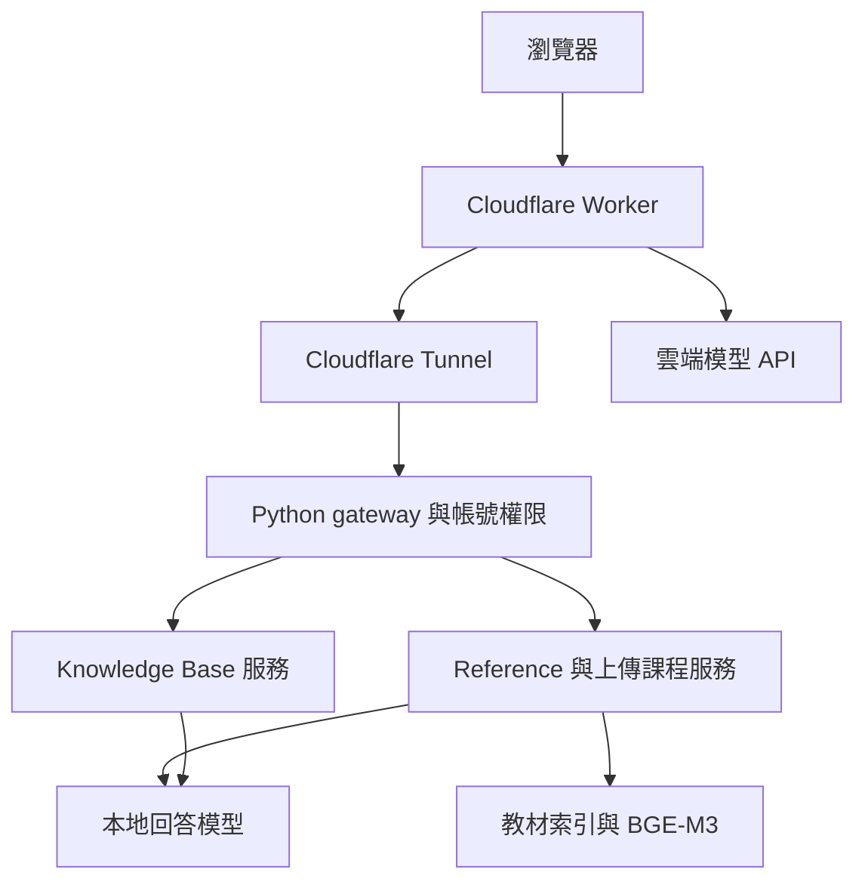

# 系統架構

[回專案首頁](../README.md) · [程式導覽](code-map.md)

本文件依目前公開程式整理。架構包含瀏覽器、Cloudflare 公開入口、Python gateway、教材服務與模型服務；各服務的實際運作仍須在部署環境確認。

## 服務與責任

Worker 同時提供靜態資產，並處理公開 API 路由與部分雲端回答流程。本地服務入口由 `gateway.py` 檢查帳號及課程存取，再轉發到對應後端。

| 預設位址 | 程式／服務 | 責任 |
|---|---|---|
| `:8179` | `gateway.py`、`lungta_auth.py` | 網頁入口、登入與教師／學生權限、課程存取 |
| `127.0.0.1:8181` | `kb_server.py` | 內建知識庫、本地回答、TTS／STT 路由 |
| `127.0.0.1:8182` | `reference_server.py` | 內建教材與上傳課程檢索、問答及準備作業 |
| `127.0.0.1:11435` | 回答用 Ollama | 可選本地模型推論 |
| `127.0.0.1:11438` | 嵌入用 Ollama | BGE-M3 文字向量化 |
| `127.0.0.1:11437` | `speech_stt_server.py` | Faster-Whisper 語音辨識 |

埠號可由部分環境變數調整，但既有完整啟動腳本仍含固定健康檢查；變更時必須同步檢查所有呼叫端。

## 內建教科書檢索

`reference_search.py` 從 `reference_corpus/chunks.jsonl` 讀取段落，建立 SQLite 段落向量與語義視窗索引。學生問題以相同 BGE-M3 模型向量化，經 cosine similarity、來源平衡與視窗重排，整理成提供模型的證據。預設最終證據上限為 6，還會受到相似度門檻與文字預算影響。

目前程式另有 `_lexical_fallback()`：當向量索引尚未就緒或嵌入失敗時，嘗試從真實教材段落做文字檢索。回傳 metadata 會記錄 fallback。結果分析應區分語義向量路徑與此備援路徑。

`scope_guard.py` 目前仍被 Reference Textbook 後端呼叫，用於生理學範圍及科學記號處理。描述現在系統時，須以這個實作為準；歷史的 Domain／Knowledge gate 實驗應另外註明版本。

## 上傳課程檢索與生成

教師上傳 PDF 後，`course_runtime.py` 使用 PyMuPDF 抽取文字與章節資訊，清理文字，再由 Python 切段。BGE-M3 負責嵌入切好的文字，並不負責決定 PDF 章節或段落邊界。每門課程使用自己的 `course_workspaces/<course_id>/` 工作區、manifest 與索引。

講稿與題庫依課程／單元內容準備。`exam_questions.py` 包含選擇題草稿與審查程序，`QUESTION_TARGET=100` 表示目標數量；不保證每個單元都能得到 100 題通過審查的題目。

## 模型、語音與回報

前端選擇的回答模型與嵌入模型是不同服務。語音辨識使用 Faster-Whisper；語音播放涉及瀏覽器語音與後端路由。切換回答模型不表示同時更換 STT 或 embedding 模型。

`feedback/feedback_service.py` 負責答案回報與更正資料。更正紀錄的查詢與再利用應依該版本實作說明；目前不能據此宣稱系統已自動重新訓練模型。

V/Q 模擬由前端的數值計算引擎處理，使用 `VERIFY_VQ_CONSERVATION.cjs` 檢查守恆、預設值、部分參考案例與錯誤輸入行為。
